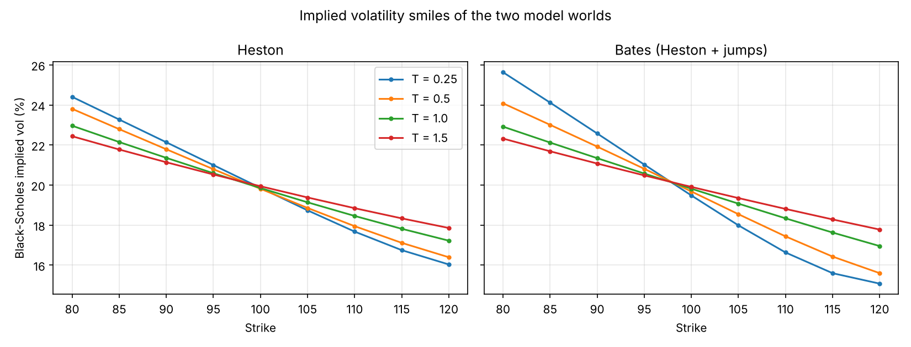
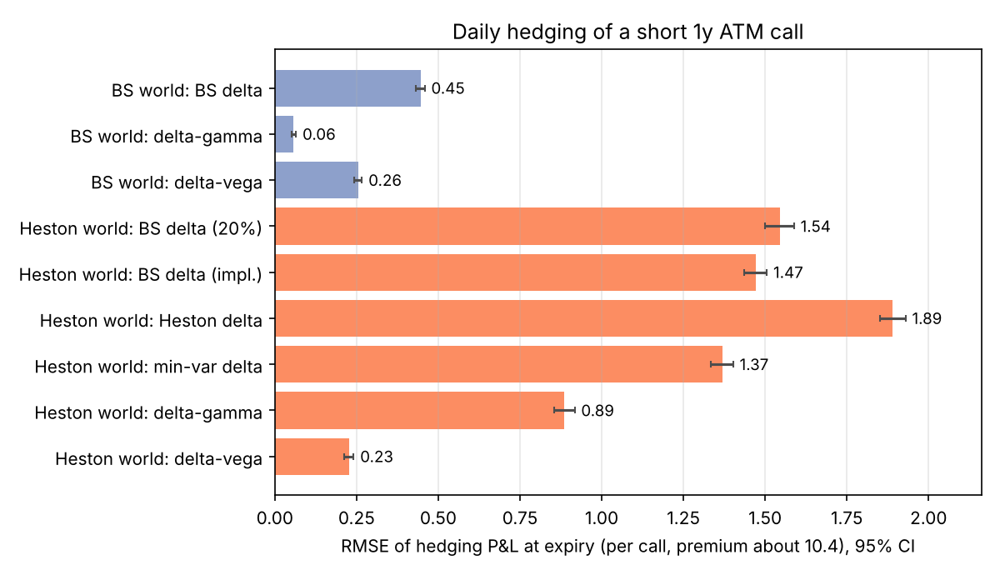
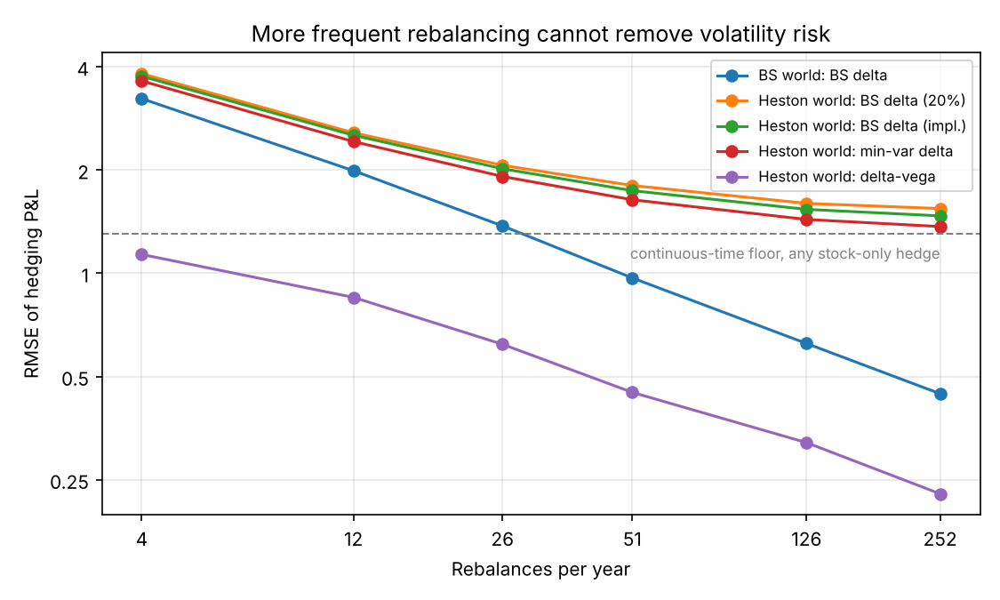
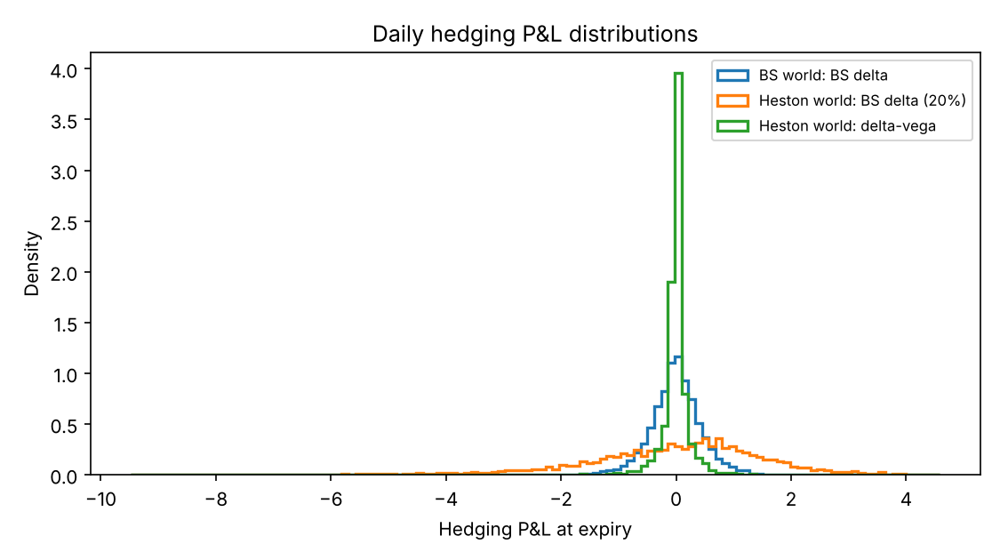
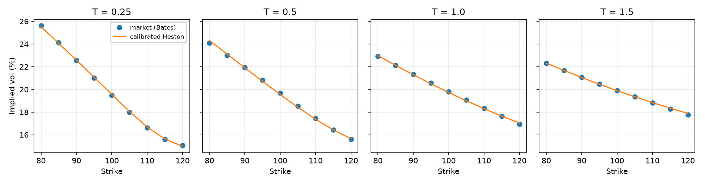
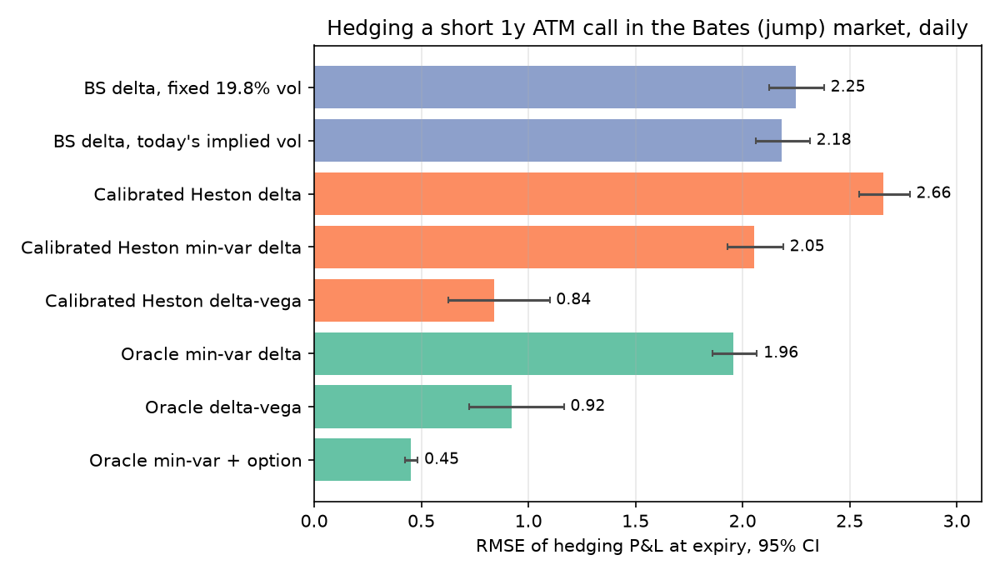
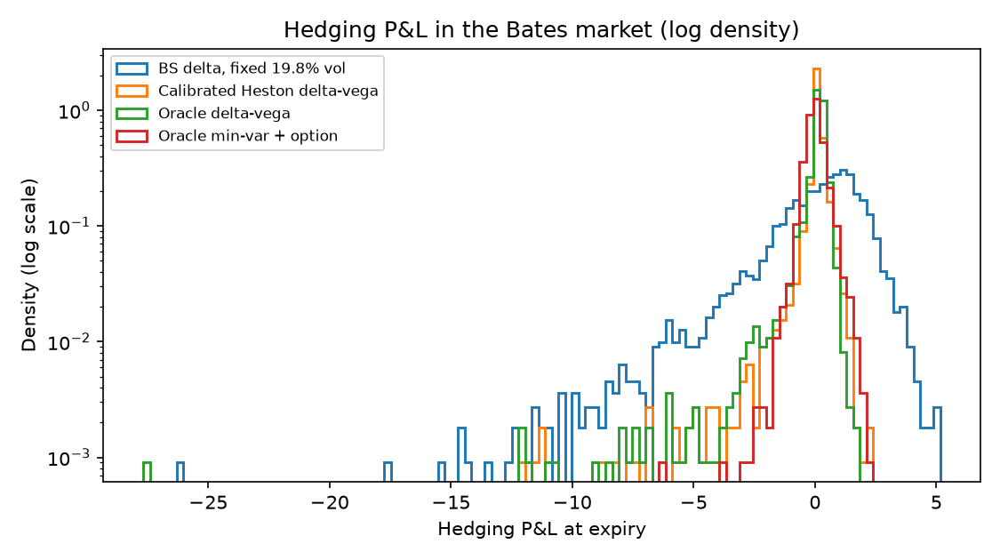

# Methodology and full results

Companion to the [README](README.md): setup, methodology and derivations, every results table, and the full list of limitations. All numbers come from the default runs saved in `results/`.

**Contents:** [Setup](#setup) · [Methodology](#methodology) · [Results](#results): [Part 1](#part-1-validation-and-smiles-01_pricingpy), [Part 2](#part-2-hedging-in-the-heston-world-02_heston_hedgingpy), [Part 3](#part-3-extension-model-risk-in-a-jump-market-03_model_riskpy) · [Limitations](#limitations) · [References](#references)

## Setup

- Short one 1-year ATM call (S0 = K = 100, r = 5%), hedged daily over 252 trading days. 4,000 paths by default in Parts 2 and 3 (`--paths`, `--seed` to change).
- **Heston world:** v0 = θ = 0.04, κ = 2, ξ = 0.3, ρ = −0.7.
- **Black-Scholes world:** σ = 20%, driven by the same stock shocks as the Heston world, so comparisons are paired.
- **Bates world** (Heston + lognormal jumps, Part 3): v0 = θ = 0.032, κ = 2, ξ = 0.3, ρ = −0.7, jump intensity λ = 0.4 per year, log jump size N(−10%, 10%²). The expected annual quadratic variation of log-returns is 0.032 + λ·E[J²] = 0.04, as in the Heston world (the ATM implied vol is not exactly 20%).
- **Option hedges** use a second call (strike 100, expiry 1.25 years), traded at model prices.
- **Hedging error** = value of the self-financing hedge portfolio at expiry minus the call payoff, in option-price units (spot starts at 100, the premium is about 10.4). I report RMSE, mean and 5% expected shortfall (ES 5%: the average loss over the worst 5% of paths), with 95% bootstrap intervals over paths (1,000 resamples). Comparisons between hedging strategies rest on paired bootstrap differences on the same paths, not on overlapping marginal intervals.

## Methodology

**Pricing.** Prices, deltas, variance vegas and gammas come from the COS Fourier method (Fang & Oosterlee, 2008); the Greeks are obtained by differentiating the COS expansion analytically. The Heston characteristic function uses the "little Heston trap" form, written without dividing by ξ², so it reduces exactly to Black-Scholes at ξ = 0. Bates prices are a Poisson mixture over the number of jumps, each term with its own integration range. The pricer also returns prices after an instant spot shock from the same characteristic-function evaluation, which the jump-aware hedge needs.

**Numerical edge cases.** The hedging loop reaches 1-day options and paths with zero variance (the Euler scheme truncates at 0), so the pricer is tested there explicitly:

- **Integration range:** the COS range is set from the mean and variance of the log-return. These are taken from the characteristic function by central differences. The usual closed-form Heston cumulants lose precision at short maturities (they understate the variance several times over for a 1-day option at low variance), which made the range too narrow.
- **Poisson cutoff:** the Bates sum is cut at 1e-10 of probability mass. A 1e-6 cut leaves price errors of order 1e-5, because the dropped many-jump terms are priced very differently from the rest.
- **Tests** (`test_sv.py`):
  - prices and deltas match independent numerical integration to 1e-5 for T from 1 day to 1.5 years and v from 0 to 0.15
  - no-arbitrage bounds hold on a wide grid
  - gamma, vega and the shocked prices match finite differences or direct repricing
  - the cumulants match the integrated variance as ξ → 0
  - the model converges to Black-Scholes at rate O(ξ)
  - Monte Carlo agrees with COS
  - the implied-variance solver recovers v (where the option has vega) from any start, and reports when no v fits
  - the hedge accounting is exactly self-financing, and the costs and recorded jumps are correct
  - the jump-aware minimum-variance hedge reduces to the min-var delta and the delta-vega hedge without jumps, and with jumps no nearby position has a smaller local variance

**Simulation.** Full-truncation Euler for the variance and log-Euler for the stock, with 4 steps per day. Jumps are simulated as compound Poisson with the risk-neutral compensator, and the number of jumps on each path and day is recorded.

**Monte Carlo check (Part 1).** All strikes are priced on the same paths, so their pricing errors are correlated and should not be read as independent validation checks; the forward E[S_T] is reported alongside.

**Stock-only hedges (Part 2).** BS delta at a fixed 20%, BS delta at today's implied vol of the sold call (what a Black-Scholes desk would actually use), the Heston delta ∂C/∂S, and the minimum-variance delta Δ + ρξ𝒱/S with 𝒱 = ∂C/∂v, which minimises the instantaneous variance of the hedged book.

**Continuous-time benchmark (Part 2).** For a stock position *a* against a short Heston call, Itô's lemma and the Heston PDE remove all drift terms from the discounted hedge error, leaving a martingale

$$d\left(e^{-rt}\,\text{error}_t\right) = e^{-rt}\left[(a-\Delta)\,S\sqrt{v}\,dW_1 - \mathcal{V}\,\xi\sqrt{v}\,dW_2\right],\qquad d\langle W_1,W_2\rangle = \rho\,dt .$$

The Itô isometry then gives its exact second moment at expiry under continuous rebalancing:

$$E[\text{error}_T^2] = E\int_0^T e^{2r(T-t)}\, v\left[(a-\Delta)^2S^2 - 2\rho\xi(a-\Delta)S\,\mathcal{V} + \xi^2\mathcal{V}^2\right]dt .$$

At the minimum-variance delta this becomes E∫e^{2r(T−t)} ξ²(1−ρ²) v 𝒱² dt, a floor for every stock-only hedge. I estimate the integral along the simulated paths with a left Riemann sum on the daily grid, and report a bootstrap interval. The gap between this continuous-time error and the simulated daily error is the cost of rebalancing only once a day. The two are not exactly orthogonal, so I don't split the daily error into additive parts; sqrt(daily² − continuous²) is reported only as a rough consistency check against the daily error in the BS world. The "floor share" (floor variance ÷ a hedge's continuous-time variance) is the clean split between volatility risk and the choice of delta, because both terms are continuous-time quantities.

**Option hedges (Part 2).** Stock plus a second call, chosen so the book is delta-neutral and either vega-neutral or gamma-neutral. Both are run in both worlds. In the BS world there is no volatility risk, so any gain there comes from gamma. A gamma-neutral hedge cancels the leading-order gamma exposure locally, the main source of discrete rebalancing error, but other discrete-hedging errors remain, and in the Heston world it still carries vega. Deep out of the money both options' Greeks are ~1e-4 and the numerical values can even be slightly negative, so their ratio is noise; where the hedge option has no usable vega (or gamma) the book holds no option, and the script reports how often (about 1% of path-days).

**Costs.** Costs are close to a fixed charge, so they mostly move the mean. The cost table reports mean and standard deviation next to RMSE (RMSE² = mean² + std²) so a predictable cost is not read as extra risk.

**Model risk with jumps (Part 3, extension).** The market follows Bates. Two hedgers trade at the same market prices on the same paths:

- **Calibrated Heston hedger:** sees only option prices. It calibrates Heston once, at t = 0, to implied vols at 9 strikes × 4 maturities. Each day it backs out its variance state from the market price of the hedge option (`implied_variance`: Newton steps safeguarded by bisection on the bracket [0, 1], since the price increases with v). If the target price lies outside the model prices at the bracket ends, it uses the nearer boundary (v = 0 or v = 1), and the script reports how often this happens and at which boundary. Because the root is bracketed, a remaining mismatch means no variance in [0, 1] fits, not that the solver failed.
- **Oracle:** knows the true Bates dynamics and parameters and reads the true variance. It is an idealised benchmark, not a feasible trader. Perfect model knowledge pays off only together with the right objective: the oracle's delta-vega hedge is not optimal under jumps, so the calibrated hedger can match or beat it; the jump-aware minimum-variance oracle is the real benchmark. Its variance input is not itself privileged: under the true model the hedge option's price determines v wherever that option has vega, and the script checks that inverting it recovers the true variance on those path-days. Deep out of the money the price hardly depends on v, so v is not identified there; but then neither option has vega and the hedges hardly depend on v either. The script reports the share of such path-days. Its real advantage is knowing the dynamics, in particular the jumps, which vanilla prices on one date did not reveal.

The oracle hedges two ways:

- **Greek-neutral:** zero delta and vega.
- **Minimum-variance:** each day it chooses stock *a* and options *q* to minimise the local variance of call − a·stock − q·option. The covariance per unit time between instruments is the Itô diffusion term plus λ·E[ΔX·ΔY], where ΔX is the exact repriced change after a jump. The expectation over jump size uses 7-point Gauss–Hermite quadrature. Under the pricing measure the hedge error is a martingale with orthogonal increments, so minimising each day's variance minimises the variance at expiry (up to discrete-time effects). With no jumps it reduces to the minimum-variance delta and the delta-vega hedge (tested). Where the hedge option has no usable vega the 2×2 system is near-singular, and the oracle then hedges with stock only.

**Decomposition (Part 3).** Paired differences answer two separate questions: the value of knowing the true model for a fixed objective (calibrated vs oracle, delta-vega and stock-only min-var), and the value of the jump-aware objective for a fixed, true model (oracle delta-vega vs oracle min-var + option). The jump analysis splits paths by whether a jump actually occurred in the simulation.

## Results

### Part 1: validation and smiles (`01_pricing.py`)

| Model, T = 1 | Strike | COS | Monte Carlo | z-score |
|---|---:|---:|---:|---:|
| Heston | 80 / 100 / 120 | 25.045 / 10.394 / 2.333 | 25.078 / 10.414 / 2.343 | 1.4 / 1.2 / 1.2 |
| Bates | 80 / 100 / 120 | 25.037 / 10.382 / 2.248 | 24.995 / 10.345 / 2.236 | −1.7 / −2.2 / −1.5 |

500,000 paths. Forward check z: Heston 1.5, Bates −1.1. The strikes are evaluated on shared simulation paths, so their pricing errors are correlated and should not be interpreted as independent validation checks. The common shift across strikes is consistent with sampling noise in the level of S_T rather than a bias that grows with strike.

*Both worlds produce the downward-sloping equity skew. In the tested specifications, Bates produces a steeper three-month skew than Heston (80-strike minus 120-strike implied vol: 10.6 vs 8.4 vol points), while their one-year skews are similar (6.0 vs 5.7). The two worlds also use different diffusion parameters, so this is not an isolated effect of jumps.*

### Part 2: hedging in the Heston world (`02_heston_hedging.py`)

| Daily hedge | RMSE | 95% CI | Mean | ES 5% |
|---|---:|---:|---:|---:|
| BS world, BS delta | 0.446 | [0.431, 0.458] | −0.003 | 1.016 |
| BS world, delta-gamma | 0.058 | [0.051, 0.065] | +0.002 | 0.104 |
| BS world, delta-vega | 0.255 | [0.244, 0.267] | +0.001 | 0.621 |
| Heston world, BS delta (20%) | 1.544 | [1.500, 1.588] | −0.019 | 3.946 |
| Heston world, BS delta (today's implied vol) | 1.471 | [1.435, 1.505] | −0.026 | 3.516 |
| Heston world, Heston delta | 1.890 | [1.852, 1.930] | −0.024 | 4.349 |
| Heston world, min-var delta | 1.369 | [1.335, 1.402] | −0.029 | 3.278 |
| Heston world, delta-gamma | 0.885 | [0.855, 0.917] | +0.001 | 1.862 |
| Heston world, delta-vega | 0.228 | [0.213, 0.241] | −0.004 | 0.608 |

Daily Black-Scholes delta hedging is 3.5x worse in the Heston world than in the Black-Scholes world (1.544 vs 0.446).

| Paired difference in RMSE (Heston world) | Difference | 95% CI |
|---|---:|---:|
| Heston delta − BS delta (20%) | +0.346 | [+0.309, +0.381] |
| BS delta (implied) − BS delta (20%) | −0.074 | [−0.101, −0.048] |
| Min-var delta − BS delta (implied) | −0.102 | [−0.116, −0.088] |
| Delta-vega − min-var delta | −1.141 | [−1.177, −1.109] |
| Delta-gamma − min-var delta | −0.484 | [−0.523, −0.442] |

**Why the Heston delta loses.** Hedge ratios at t = 0: BS delta 0.637, BS delta at implied vol 0.637, Heston delta 0.692, min-var delta 0.610. The Heston delta over-hedges. With ρ = −0.7 a fall in the stock tends to come with a rise in variance, which raises the call's value and offsets part of the stock move; the min-var delta builds this in through the ρξ𝒱/S term, the Heston delta ignores it. A BS delta happens to sit closer to the min-var delta, so it does better than the "correct" model's delta. Price sensitivity and the variance-minimising position are different things once volatility is random.

| Stock-only hedge, Heston world | Continuous-time, Itô (95% CI) | Daily, simulated | Floor share of variance |
|---|---:|---:|---:|
| BS delta (20%) | 1.485 [1.475, 1.495] | 1.544 | 77% |
| BS delta (implied) | 1.401 [1.393, 1.410] | 1.471 | 87% |
| Heston delta | 1.829 [1.818, 1.841] | 1.890 | 51% |
| Min-var delta | 1.306 [1.299, 1.315] | 1.369 | 100% |

**How much is volatility risk?** The floor that no stock-only hedge can beat (RMSE 1.31) accounts for 87% of the continuous-time variance of BS delta at today's implied vol, 77% at a fixed 20% vol and only 51% for the Heston delta; the rest comes from the choice of delta. By the rough check in the script, daily rebalancing adds about the same error (≈0.41–0.48) in both worlds, so the extra error in the Heston world is mostly continuous-time volatility risk, not discretisation.

**What the second option does.** Delta-vega hedging brings the Heston-world RMSE down to 0.23, against 0.26 for the same hedge in a constant-vol world. A gamma-neutral hedge, which cancels gamma but leaves vega exposure, only gets to 0.89. With a Heston market and a second option priced by Heston the market is complete, so this part confirms the mechanics rather than testing a hypothesis; Part 3 tests the option hedge in a market it does not describe.

*In the Black-Scholes world the error falls like 1/√n with the number of rebalances (fitted slope −0.49 over 51–252 rebalances; theory −0.5). In the Heston world the stock-only hedges level off at non-zero limits that depend on the delta used (continuous-time RMSE 1.49 for BS delta at 20%, 1.40 at implied vol, 1.31 for the min-var delta); only the min-var delta approaches the floor that no stock-only hedge can beat (dashed line). Trading more often cannot hedge volatility; only the option hedge keeps improving.*

| RMSE by rebalances per year | 4 | 12 | 26 | 51 | 126 | 252 |
|---|---:|---:|---:|---:|---:|---:|
| BS world, BS delta | 3.230 | 1.991 | 1.375 | 0.970 | 0.624 | 0.446 |
| Heston world, BS delta (20%) | 3.820 | 2.569 | 2.065 | 1.803 | 1.599 | 1.544 |
| Heston world, BS delta (implied) | 3.755 | 2.526 | 2.018 | 1.742 | 1.536 | 1.471 |
| Heston world, min-var delta | 3.638 | 2.422 | 1.916 | 1.638 | 1.436 | 1.369 |
| Heston world, delta-vega | 1.135 | 0.851 | 0.621 | 0.450 | 0.321 | 0.228 |

**Among the daily and weekly schedules tested, costs reverse the preferred rebalancing frequency for the option hedge.** Without costs, daily delta-vega rebalancing is better (0.228). Under the assumed costs of 2 bp on stock and 1% of the option price, weekly rebalancing achieves lower RMSE than daily (0.641 vs 0.763). The reason is cost, not risk: daily option trading costs 0.64 on average against 0.40 weekly, while the spread of outcomes is actually wider when rebalancing weekly (std 0.489 vs 0.413). For the stock-only hedges costs are small (about 0.12) and daily rebalancing stays best. Under these assumptions delta-vega still beats every stock-only hedge, but its advantage over the min-var delta shrinks from 1.14 to 0.62 at daily rebalancing.

| With costs (2 bp stock, 1% option price, incl. unwind) | Rebalance | RMSE | Mean | Std | Mean cost |
|---|---|---:|---:|---:|---:|
| BS delta (20%) | daily | 1.564 | −0.141 | 1.558 | 0.121 |
| BS delta (20%) | weekly | 1.810 | −0.124 | 1.806 | 0.070 |
| BS delta (implied) | daily | 1.482 | −0.150 | 1.475 | 0.123 |
| BS delta (implied) | weekly | 1.746 | −0.124 | 1.741 | 0.071 |
| Min-var delta | daily | 1.382 | −0.153 | 1.374 | 0.123 |
| Min-var delta | weekly | 1.645 | −0.126 | 1.640 | 0.071 |
| Delta-vega | daily | 0.763 | −0.642 | 0.413 | 0.638 |
| Delta-vega | weekly | 0.641 | −0.415 | 0.489 | 0.399 |

*Volatility risk shows up in the tails: the 5% expected shortfall of BS delta hedging rises from 1.02 in the Black-Scholes world to 3.95 in the Heston world, and delta-vega hedging brings it back to 0.61.*

### Part 3 (extension): model risk in a jump market (`03_model_risk.py`)

*A Heston model calibrated to the Bates market's implied vols (9 strikes × 4 maturities) fits to 0.076 vol points overall, with the worst maturity (T = 0.5) at 0.112.*

Calibrated Heston: v0 = 0.0394, θ = 0.0399, κ = 3.786, ξ = 0.456, ρ = −0.707, against the true diffusion part v0 = θ = 0.032, κ = 2, ξ = 0.3, ρ = −0.7 plus jumps. The calibration absorbs the jumps into a higher variance level and a higher vol-of-vol. Feller condition holds (0.302 > 0.208).

**Fitting today's surface is not the same as being dynamically consistent.** Each day the calibrated hedger backs out its variance from the hedge option's market price. On 5.94% of path-days (48.9% of paths at least once) no variance in [0, 1] reprices that option. All failures occur at the lower boundary: the model is too expensive even at v = 0, by 0.085 on average. They cluster on days with very low true variance (0.0039 on average, against 0.032 overall), where vega is small. Over all days its implied variance tracks the true variance closely (correlation 0.994) but is biased upwards (mean 0.041 vs 0.032). Despite these failures, the calibrated hedger's Greek hedges perform comparably to the oracle's Greek hedges (below). How much the failures themselves cost is not isolated here.

Other checks: the oracle's variance is recovered from prices to within 7.5e-9 where the hedge option's variance vega exceeds 0.1, and is not identified on 0.83% of sampled path-days. No option held: oracle 0.29%, calibrated 1.42% of path-days (0.03% on inversion-failure days).

*In the jump market no Greek-based hedge reaches the jump-aware minimum-variance hedge (bottom bar). Note the wide intervals of the delta-vega hedges: their losses come from rare jumps, which is why the paired comparisons below are the reliable ones.*

| Daily hedge in the Bates market | RMSE | 95% CI | Mean | ES 5% |
|---|---:|---:|---:|---:|
| BS delta, fixed ATM implied vol (19.8%) | 2.247 | [2.126, 2.381] | +0.012 | 6.836 |
| BS delta, today's implied vol | 2.181 | [2.062, 2.315] | +0.004 | 6.520 |
| Calibrated Heston delta | 2.656 | [2.545, 2.781] | +0.001 | 7.571 |
| Calibrated Heston min-var delta | 2.053 | [1.930, 2.190] | +0.005 | 6.108 |
| Calibrated Heston delta-vega | 0.839 | [0.626, 1.099] | +0.011 | 2.142 |
| Oracle min-var delta | 1.957 | [1.859, 2.068] | +0.003 | 5.412 |
| Oracle delta-vega | 0.920 | [0.724, 1.166] | +0.014 | 2.616 |
| Oracle min-var + option | 0.452 | [0.425, 0.484] | −0.003 | 1.021 |

| Paired difference in RMSE (first − second) | Difference | 95% CI |
|---|---:|---:|
| *Model knowledge, objective fixed* | | |
| Calibrated min-var delta − oracle min-var delta | +0.095 | [+0.061, +0.134] |
| Calibrated delta-vega − oracle delta-vega | −0.081 | [−0.112, −0.059] |
| *Objective, true model known* | | |
| Oracle delta-vega − oracle min-var + option | +0.468 | [+0.276, +0.707] |
| Oracle min-var delta − oracle min-var + option | +1.505 | [+1.410, +1.613] |
| *Both together* | | |
| Calibrated delta-vega − oracle min-var + option | +0.387 | [+0.180, +0.639] |

**Model knowledge versus objective.** For a fixed objective, knowing the true model changed little in this scenario: the calibrated stock-only min-var delta is worse than the oracle's by 0.10, and for delta-vega the calibrated hedger is even slightly better (−0.08; −0.11 on a second seed, see below). A possible reason, not tested here, is that its inflated vol-of-vol makes it hold more of the hedge option (0.84 vs 0.76 on average), which covers part of the jump risk. Changing the objective mattered more: for the true model, switching from delta-vega to jump-aware minimum variance reduces RMSE from 0.920 to 0.452 (by 0.47 [0.28, 0.71]). The calibrated hedger cannot make that switch, because its model has no jumps.

**Robustness to a second seed.** Rerunning Part 3 on a different set of 4,000 paths (`--seed 8`, output in `results/03_model_risk_paths4000_seed8.txt`) gives the same sign for every paired comparison, with slightly larger effects:

| Paired difference in RMSE (first − second) | Seed 7 (reported above) | Seed 8 |
|---|---:|---:|
| Calibrated min-var delta − oracle min-var delta | +0.095 [+0.061, +0.134] | +0.121 [+0.085, +0.163] |
| Calibrated delta-vega − oracle delta-vega | −0.081 [−0.112, −0.059] | −0.109 [−0.142, −0.081] |
| Oracle delta-vega − oracle min-var + option | +0.468 [+0.276, +0.707] | +0.619 [+0.432, +0.811] |
| Oracle min-var delta − oracle min-var + option | +1.505 [+1.410, +1.613] | +1.541 [+1.434, +1.681] |
| Calibrated delta-vega − oracle min-var + option | +0.387 [+0.180, +0.639] | +0.510 [+0.323, +0.708] |

The variance inversion fails on 5.64% of path-days (vs 5.94%), and the split by jumps shows the same pattern.

| By actual jumps (33.4% of paths had one; expected 33.0%) | RMSE, no jump | RMSE, ≥ 1 jump |
|---|---:|---:|
| Calibrated Heston min-var delta | 1.424 | 2.927 |
| Oracle min-var delta | 1.475 | 2.670 |
| Calibrated Heston delta-vega | 0.294 | 1.391 |
| Oracle delta-vega | 0.317 | 1.528 |
| Oracle min-var + option | 0.390 | 0.554 |

*The left tail is where the hedges differ. On paths with at least one jump, the jump-aware hedge's RMSE is 0.554 against 1.528 for the oracle delta-vega hedge, while on paths without jumps it is slightly worse (0.390 vs 0.317): it gives up a little in quiet markets to protect against jumps. This split is a descriptive comparison of path subsets, not a separate experiment.*

## Limitations

- **Simulated markets only:** one parameter set per world, no real data. The Bates market stands in for reality but is still a model, so these improvements would not necessarily carry over to live trading.
- **Model prices:** options trade at model prices, and costs are a simple proportional charge. Rebalancing is on a fixed schedule.
- **Measure:** the minimum-variance hedges minimise variance under the pricing measure. With risk premia on volatility or jumps, the real-world optimal hedge would differ.
- **Continuous-time benchmark:** it is estimated on the daily grid along simulated paths, so it carries Monte Carlo error and a small discretisation error.
- **Calibration:** the calibrated hedger calibrates once and never recalibrates. Daily recalibration would change its results, in either direction.
- **Oracle:** an idealised benchmark, not an achievable strategy. Knowing the true model only guarantees the best result together with the right objective: the jump-aware minimum-variance oracle is the benchmark, while the oracle's delta-vega hedge is not optimal under jumps and is slightly beaten by the calibrated Heston delta-vega hedge on both seeds tested.
- **Statistics:** jump losses make the Part 3 RMSE distribution heavy-tailed, so marginal bootstrap intervals are wide and the paired differences are the reliable comparisons. A second seed gives the same sign for every paired comparison (see Part 3). Bootstrap intervals measure Monte Carlo noise only, not parameter uncertainty; the calibration itself is deterministic (it fits model prices at t = 0). The cost and rebalancing comparisons are reported without intervals.
- **Complete-market benchmark:** in Part 2 the hedge option trades at Heston prices in a Heston market, so delta-vega hedging is perfect in continuous time by construction. Part 3 is where it is tested against a market it does not describe.
- **Simulation scheme:** full-truncation Euler is validated against COS prices, but Andersen's QE scheme would be more accurate for larger ξ.

## References

- Heston (1993), A closed-form solution for options with stochastic volatility, *Review of Financial Studies*.
- Bates (1996), Jumps and stochastic volatility, *Review of Financial Studies*.
- Albrecher, Mayer, Schoutens & Tistaert (2007), The little Heston trap, *Wilmott*.
- Fang & Oosterlee (2008), A novel pricing method for European options based on Fourier-cosine series expansions, *SIAM J. Sci. Comput.*
- Andersen (2008), Simple and efficient simulation of the Heston stochastic volatility model, *Journal of Computational Finance*.
- Schweizer (1991), Option hedging for semimartingales, *Stochastic Processes and their Applications*.
- Gatheral (2006), *The Volatility Surface*.
