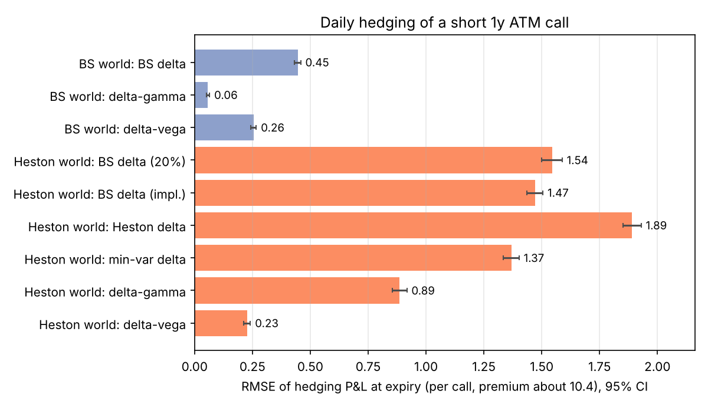
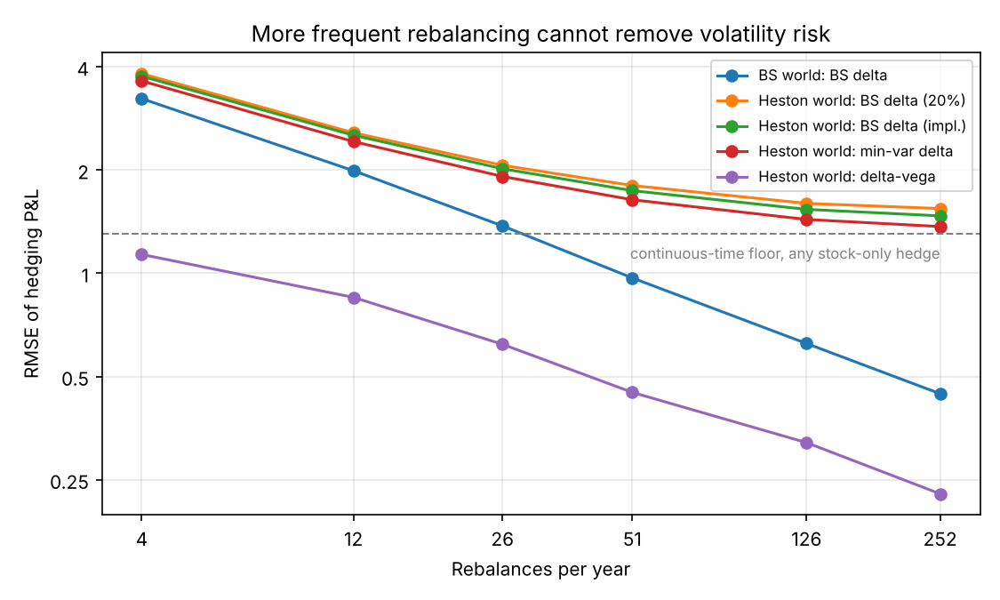
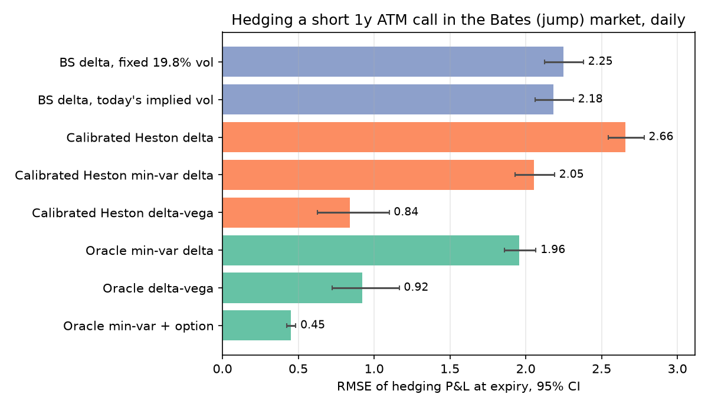

# Hedging Under Stochastic Volatility and Model Risk

*Python · Heston / Bates · Fourier-COS pricing · Monte Carlo · dynamic hedging · model risk*

How do stochastic volatility, the choice of hedging instrument and a misspecified model affect the risk of dynamically hedging a short European call? All results come from simulated markets with known dynamics, so every hedge can be compared against the truth.

## Main findings

1. **The model-consistent delta is not the best hedge.** In a Heston market, hedging with the Heston delta ∂C/∂S gives RMSE 1.89, worse than a plain Black-Scholes delta (1.54). I derive the minimum-variance hedge and, via the Itô isometry, the continuous-time error floor that no stock-only hedge can beat (RMSE 1.31).
2. **A second option removes most of the risk, but costs change the trade-off.** In the model-consistent Heston market, delta-vega hedging cuts RMSE by 83% relative to the best stock-only hedge. With proportional costs, weekly delta-vega rebalancing beats daily in RMSE (0.64 vs 0.76), because it pays less in option trading costs.
3. **A near-perfect calibration still misses the risk that matters.** Heston fits a synthetic Bates (jump) market to 0.076 vol points with the wrong parameters. In that tested scenario, a jump-aware minimum-variance hedge reduced RMSE from 0.920 to 0.452 against the true-model delta-vega hedge, a larger gain than switching between the calibrated and the true model.



*Daily hedging of a short 1-year ATM call (premium ≈ 10.4), lower is better. In the Heston world (orange), the best stock-only hedge (min-var delta) has RMSE 1.37; adding a second option (delta-vega) cuts it to 0.23 in the same market. The blue bars show the same hedges in a Black-Scholes world for reference.*

**Why the numbers can be trusted:** the pricer is checked against independent numerical integration down to 1-day options and zero variance, the simulator against the pricer, and the headline hedge comparisons use paired bootstrap intervals on the same paths. 80 tests, fixed seeds, saved outputs in `results/`.

**Full methodology, derivations and every results table: [DETAILS.md](DETAILS.md).**

## Setup

A short 1-year ATM call (S0 = K = 100, r = 5%) is hedged daily over 252 days on 4,000 simulated paths, in three markets: Black-Scholes (σ = 20%), Heston (v0 = θ = 0.04, κ = 2, ξ = 0.3, ρ = −0.7) and Bates (Heston plus lognormal jumps, λ = 0.4 per year). Option hedges use a second call (strike 100, expiry 1.25 years). The hedging error is the hedge portfolio's value at expiry minus the call payoff, in option-price units; I report its RMSE.

Prices and Greeks come from the COS Fourier method (Fang & Oosterlee, 2008), paths from a full-truncation Euler scheme.

## Results

### Why the Heston delta loses

With ρ = −0.7 a fall in the stock tends to come with a rise in variance, which raises the call's value and offsets part of the stock move. The minimum-variance delta Δ + ρξ(∂C/∂v)/S builds this in; the Heston delta ignores it and over-hedges (0.69 vs 0.61 at t = 0). Price sensitivity and the variance-minimising position are different things once volatility is random. The difference is significant on paired paths: Heston delta minus BS delta RMSE +0.35 [+0.31, +0.38].

| Daily hedge, Heston world | RMSE | 95% CI |
|---|---:|---:|
| Black-Scholes delta (20% vol) | 1.544 | [1.500, 1.588] |
| Heston delta | 1.890 | [1.852, 1.930] |
| Minimum-variance delta | 1.369 | [1.335, 1.402] |
| Delta-gamma (stock + option) | 0.885 | [0.855, 0.917] |
| Delta-vega (stock + option) | 0.228 | [0.213, 0.241] |
| *For reference: BS delta in a Black-Scholes world* | *0.446* | *[0.431, 0.458]* |

### Trading more often cannot hedge volatility



*In the Black-Scholes world the error falls like 1/√n with the number of rebalances (fitted slope −0.49; theory −0.5). In the Heston world the stock-only hedges level off at non-zero limits that depend on the delta used; only the min-var delta approaches the floor that no stock-only hedge can beat (dashed line). Only the option hedge keeps improving.*

**Costs.** Among the daily and weekly schedules tested, costs reverse the preferred frequency for the option hedge: under the assumed costs (2 bp on stock, 1% of the option price), weekly delta-vega rebalancing achieves lower RMSE than daily (0.641 vs 0.763). The gain is lower cost, not lower risk: the spread of outcomes is wider weekly (std 0.489 vs 0.413).

### Model risk in a jump market

A Heston model calibrated to the Bates market fits its implied vols to 0.076 vol points, with clearly wrong parameters (κ = 3.8 vs 2, ξ = 0.46 vs 0.30). Fitting today's surface is not the same as being dynamically consistent: on 5.94% of path-days no variance makes the calibrated model reprice the hedge option.



*Two hedgers trade at the same prices on the same paths: a calibrated Heston hedger that sees only option prices, and an oracle that knows the true Bates model. No Greek-based hedge reaches the oracle's jump-aware minimum-variance hedge (bottom bar).*

For a fixed hedging rule, knowing the true model changed little in this scenario: for delta-vega the calibrated hedger was even slightly better (−0.08 [−0.11, −0.06]; −0.11 [−0.14, −0.08] on a second seed). Changing the objective mattered more: for the true model, the jump-aware hedge cut RMSE from 0.920 to 0.452 (paired difference 0.47 [0.28, 0.71]). On paths with at least one jump its RMSE is 0.55 against 1.53; on paths without jumps it is slightly worse (0.39 vs 0.32).

## Limitations

- Simulated markets only, one parameter set per world: the results show mechanisms, not live-trading performance.
- Options trade at model prices; costs are a simple proportional charge; rebalancing is on a fixed schedule.
- Minimum-variance hedges are computed under the pricing measure, ignoring volatility and jump risk premia.
- In Part 2 the market is complete by construction, so delta-vega hedging is perfect in continuous time; Part 3 tests it in a market it does not describe.
- The oracle is an idealised benchmark. Part 3 is reported for one seed; a second seed gives the same sign for every paired comparison.

More detail in [DETAILS.md](DETAILS.md#limitations).

## Reproduce

```bash
pip install -r requirements.txt
python -m pytest -q             # 80 tests, ~15 s
python 01_pricing.py            # Part 1, ~15 s
python 02_heston_hedging.py     # Part 2, ~2 min (--paths 1000 for a quick run)
python 03_model_risk.py         # Part 3, ~20 min (--paths, --seed to change)
```

Tested with Python 3.14. Run from this folder; figures go to `figures/` and each script's printed output to `results/`. Runs with a non-default `--paths` or `--seed` save their console output to a separate file but overwrite the figures; with fewer paths the numbers differ slightly.

```
sv.py                  model code: Black-Scholes, Heston/Bates COS pricer, simulation, hedge P&L,
                       jump-aware minimum-variance hedge
01_pricing.py          Part 1: pricer vs Monte Carlo, implied-vol smiles
02_heston_hedging.py   Part 2: hedging in the Heston world, continuous-time benchmark
03_model_risk.py       Part 3: calibrated Heston vs oracle hedging in a Bates market
test_sv.py             numerical, accounting and hedge-ratio tests
DETAILS.md             full methodology, derivations and results tables
results/               console output of each script
figures/               figures
```

References
Heston (1993), A closed-form solution for options with stochastic volatility, Review of Financial Studies.
Bates (1996), Jumps and stochastic volatility, Review of Financial Studies.
Fang & Oosterlee (2008), A novel pricing method for European options based on Fourier-cosine series expansions, SIAM J. Sci. Comput.
